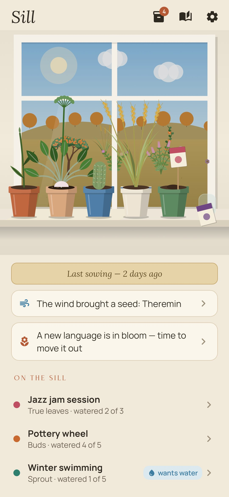
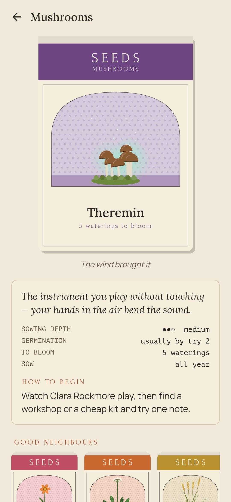
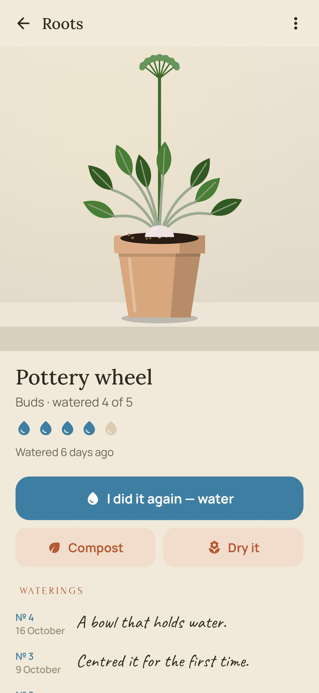
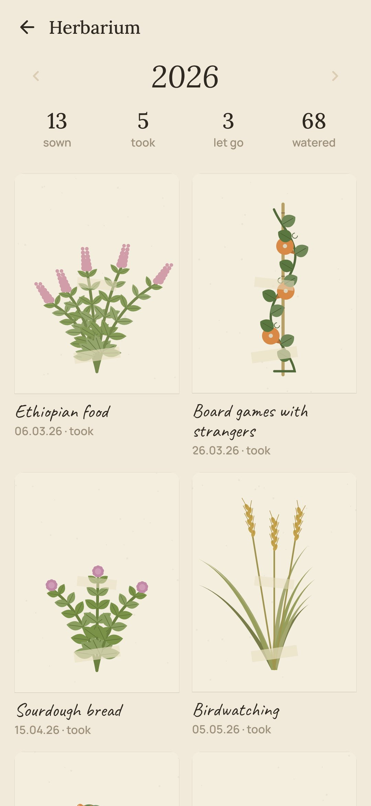
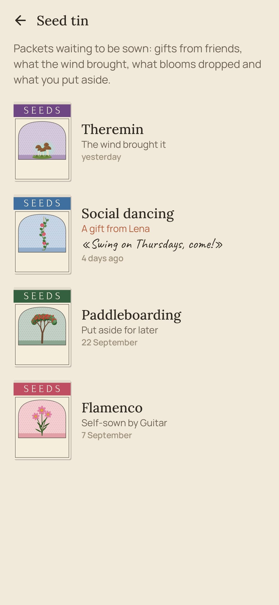

<div align="center">


# Sill

### Five pots for everything you've never tried.

*With the years we stop learning new things: the same music, the same food, the same places, the same people. Sill is a windowsill with five pots. Sowing a seed is trying something new. Watering it is going back and doing it again. When it blooms it's yours, and it moves out into the garden beyond the window. Free, no ads, no account, no internet.*

[](https://github.com/bigdevwhale/sill/actions/workflows/android.yml)
[](https://github.com/bigdevwhale/sill/releases/latest)


[](LICENSE)

**English** · [Русский](README.ru.md) · [Changelog](CHANGELOG.md)

    

</div>

---

## The idea

Almost nothing new feels good the first time. The first oyster, the first jazz jam, the first evening at a pottery wheel: strange, awkward, "not for me". Most people stop there, and the circle of what they like quietly shrinks year after year. Sill is built around one honest rule: a seed doesn't come up from one watering. You go back two, three, ten times, and only then decide.

## How it works

1. **The seed catalogue.** 121 packets in eight sections, printed like old lithographs: herbs are tastes and kitchens, flowers are music and art, roots are crafts, grains are learning, vines are people, cacti are the uncomfortable, mushrooms are the night and the strange, trees are long skills. The back of every packet: sowing depth, germination (by which try it usually starts to feel good), waterings to bloom, when to sow, good neighbours, and one concrete first step.
2. **Five pots.** Sowing takes a pot, and there are only five, so you can't start twenty hobbies and drop them all.
3. **Watering.** Did it again? Water it, with a line about how it went and, if you like, a photo from the phone's own camera. The plant goes from seed leaves to true leaves, buds and bloom. A radish (a new kitchen) blooms in three waterings, an oak (the cello) in forty.
4. **Thirst, without nagging.** A plant left alone slowly droops and fades. No notifications: you just see who wants water when you open the window.
5. **The garden beyond the window.** A bloom moves out of its pot and into the garden for good. The garden grows over the years, in the light of the hour and the season.
6. **Compost and the vase.** Didn't take? That's a fair result, not a failure. It goes to the compost, and the next seed sown on it needs fewer waterings. Or dry it and keep it in the vase on the sill.
7. **The seed tin.** Once a week the wind leaves a seed on the sill, from the section you've sown least. Blooms drop their neighbours' seeds. You can put packets aside for later.
8. **Gifts.** Give a friend a packet with a sticky note: "try it, I loved it". It travels as plain text through any messenger; with Sill, they share it back in and it lands in their tin.
9. **Your own packets** for whatever the catalogue doesn't have, and **the herbarium**: every seed of the year pressed on a sheet, whatever became of it.

## Privacy

No account, no ads, no analytics, no internet permission. Everything stays on the phone. Photos are taken with the phone's own camera app and kept in the app's private files.

## Building

```bash
./gradlew testDebugUnitTest assembleDebug              # app.sill.dev, next to a real install
./gradlew assembleDebug -Pdemo                         # app.sill.demo with a lived-in sill
./gradlew testDebugUnitTest -Prender --tests '*RenderArt*' && python tools/shots.py   # screenshots and the plant sheet
python tools/icon.py                                   # the logo
python tools/res.py                                    # theme, the launcher icon, the camera's file paths
```

Kotlin, Jetpack Compose, Room, DataStore. Everything is drawn in code: the window with its sky and garden, the pots, every plant (eight kinds, grown from a seed number so no two are alike), the seed packets. The catalogue is `app/src/main/assets/seeds.tsv`.

## License

[MIT](LICENSE). Fonts: Lora, Forum, Manrope, Caveat and PT Mono, all under the SIL Open Font License.
