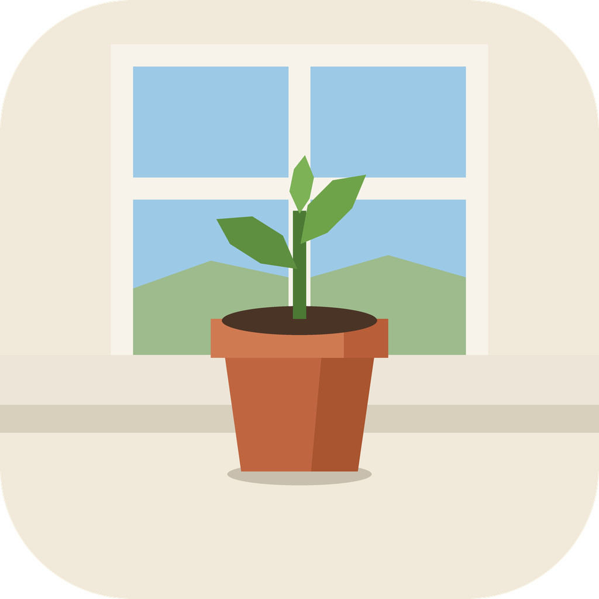
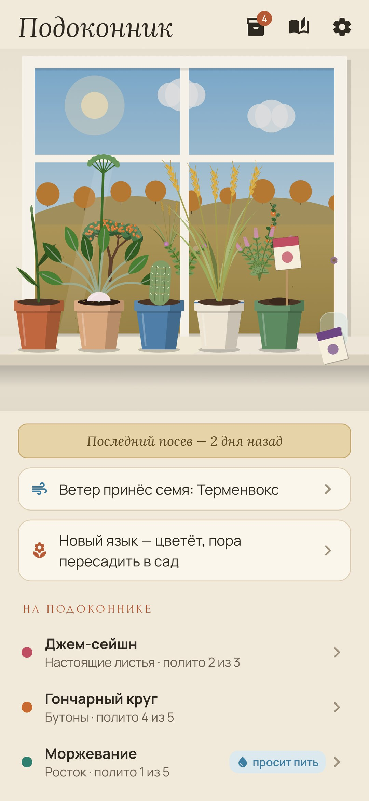
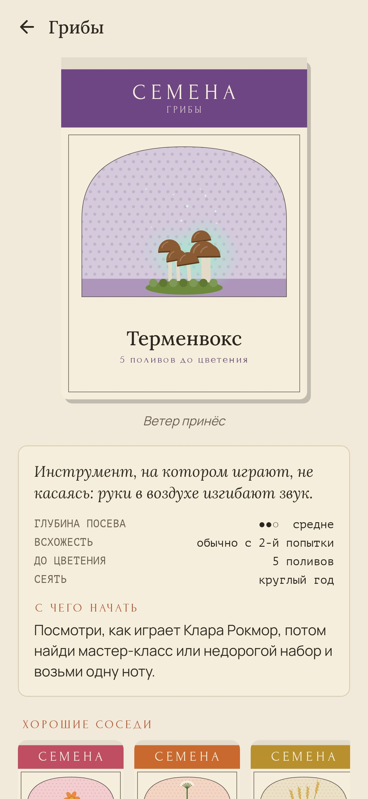
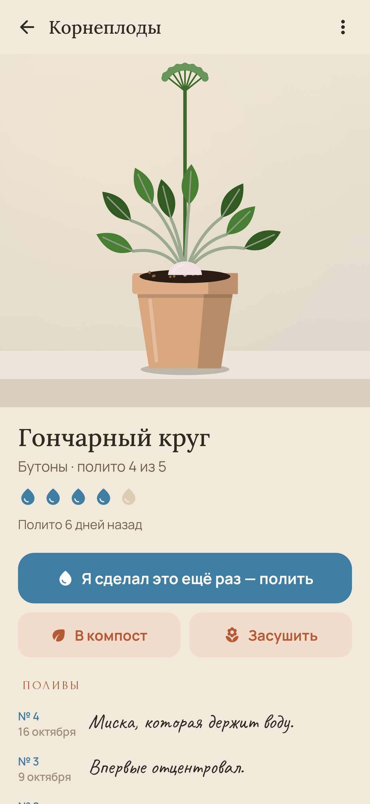
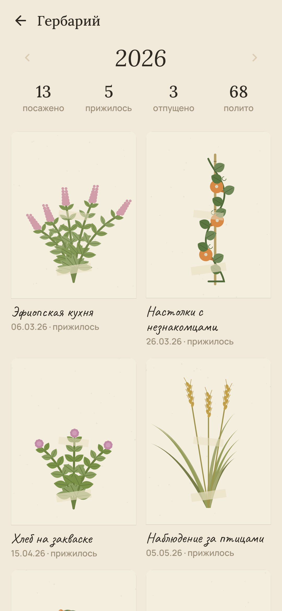
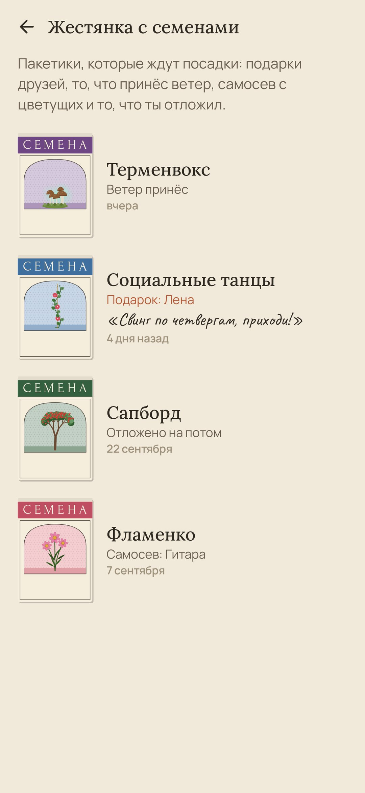

<div align="center">



# Подоконник

### Пять горшков для всего, что ты ещё не пробовал.

*С годами мы перестаём учиться новому: та же музыка, та же еда, те же места, те же люди. Подоконник — это пять горшков. Посадить семя значит попробовать что-то новое. Полить — вернуться и сделать ещё раз. Расцвело — значит, теперь это твоё, и оно переезжает в сад за окном. Бесплатно, без рекламы, без аккаунта, без интернета.*

[](https://github.com/bigdevwhale/sill/actions/workflows/android.yml)
[](https://github.com/bigdevwhale/sill/releases/latest)


[](LICENSE)

[English](README.md) · **Русский** · [Изменения](CHANGELOG.md)

    

</div>

---

## Идея

Почти ничего новое не нравится с первого раза. Первая устрица, первый джем-сейшн, первый вечер за гончарным кругом: странно, неловко, «не моё». Большинство на этом останавливается, и круг того, что нравится, тихо сужается год за годом. Подоконник построен на одном честном правиле: семя не всходит от одного полива. Возвращаешься два, три, десять раз — и только потом решаешь.

## Как это работает

1. **Каталог семян.** 121 пакетик в восьми разделах, напечатанных как старые литографии: пряные травы — вкусы и кухни, цветы — музыка и искусство, корнеплоды — ремёсла, злаки — учёба, вьюнки — люди, кактусы — некомфортное, грибы — ночное и странное, деревья — долгие навыки. На обороте каждого пакетика: глубина посева, всхожесть (с какой попытки обычно начинает нравиться), сколько поливов до цветения, когда сеять, хорошие соседи и один конкретный первый шаг.
2. **Пять горшков.** Посадка занимает горшок, а их всего пять: нельзя начать двадцать хобби и все бросить.
3. **Полив.** Сделал ещё раз? Полей — со строчкой о том, как прошло, и, если хочется, с фото через системную камеру. Растение проходит путь от семядолей до настоящих листьев, бутонов и цветения. Редиска (новая кухня) цветёт за три полива, дуб (виолончель) — за сорок.
4. **Жажда без упрёков.** Заброшенное растение постепенно никнет и выцветает. Никаких уведомлений: просто открываешь окно и видишь, кто просит пить.
5. **Сад за окном.** Расцветшее уходит из горшка в сад насовсем. Сад растёт годами, в свете часа и времени года.
6. **Компост и вазочка.** Не прижилось? Это честный результат, а не провал. Растение уходит в компост, и следующее семя на нём вырастет за меньшее число поливов. Или его можно засушить и поставить в вазочку на подоконнике.
7. **Жестянка с семенами.** Раз в неделю ветер оставляет на подоконнике семя из раздела, который ты сажал реже всего. Цветущие роняют семена соседей. Пакетики можно откладывать на потом.
8. **Подарки.** Подари другу пакетик с запиской: «попробуй, мне зашло». Он уходит обычным текстом через любой мессенджер; если у друга есть Подоконник, он делится сообщением с приложением, и пакетик оказывается в его жестянке.
9. **Свои пакетики** для всего, чего нет в каталоге, и **гербарий**: каждое семя года, засушенное на листе, чем бы оно ни стало.

## Приватность

Без аккаунта, рекламы, аналитики и даже разрешения на интернет. Всё хранится только на телефоне. Фото снимаются системной камерой и лежат в личных файлах приложения.

## Сборка

```bash
./gradlew testDebugUnitTest assembleDebug              # app.sill.dev, рядом с настоящей установкой
./gradlew assembleDebug -Pdemo                         # app.sill.demo с обжитым подоконником
./gradlew testDebugUnitTest -Prender --tests '*RenderArt*' && python tools/shots.py   # скриншоты и лист растений
python tools/icon.py                                   # логотип
python tools/res.py                                    # тема, иконка, пути для камеры
```

Kotlin, Jetpack Compose, Room, DataStore. Всё нарисовано в коде: окно с небом и садом, горшки, каждое растение (восемь видов, выращенных из случайного числа, так что двух одинаковых не бывает), пакетики семян. Каталог лежит в `app/src/main/assets/seeds.tsv`.

## Лицензия

[MIT](LICENSE). Шрифты: Lora, Forum, Manrope, Caveat и PT Mono — все под SIL Open Font License.
